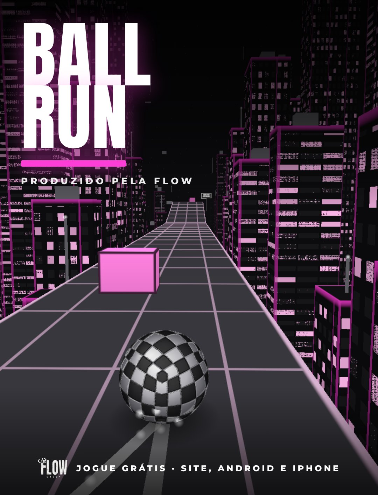

<p align="center"></p>

# Ball Run — Flow Group

Jogo 3D de bola rolando pela cidade: desvie dos blocos (alguns têm cara de poucos amigos), passe nos aceleradores e use o **poder especial** da sua bola com dois toques na tela. Feito pela [Flow Group](https://flowgroupbr.site) num tempo livre, para mostrar o nosso trabalho.

## Jogar

| Onde | Como | Internet? |
|---|---|---|
| **Online, qualquer aparelho** | abra **https://ballrun-flow.vercel.app** no navegador | só para abrir (depois funciona offline) |
| **Android** | baixe [`downloads/BallRun-Flow.apk`](downloads/BallRun-Flow.apk) e instale (permita "apps desconhecidos") | não |
| **iPhone** | baixe [`downloads/BallRun-Flow.ipa`](downloads/BallRun-Flow.ipa): é de teste, **sem assinatura da Apple**; instale com AltStore, Sideloadly ou similar (assina com o seu ID Apple) | não |

No iPhone sem instalador: abra o site no Safari › Compartilhar › **Adicionar à Tela de Início**.

Os três são o **mesmo jogo** (mesma base de código): pista, 52 bolas com poderes, 50 rastros, 500 conquistas, recordes e créditos iguais. A versão de cada arquivo está em [`downloads/VERSAO.txt`](downloads/VERSAO.txt).

**Siga a Flow:** [Instagram @flowgroup.br](https://www.instagram.com/flowgroup.br/) · [TikTok @flowgroupbr](https://www.tiktok.com/@flowgroupbr) · [WhatsApp](https://wa.me/5527992785043) · [flowgroupbr.site](https://flowgroupbr.site)

## Como o repositório publica tudo

- Push na `main` → a **Vercel** publica o site.
- O GitHub Actions (`.github/workflows/build.yml`) testa e gera as três versões: Web (testes em Chromium e WebKit), **APK** (testado num emulador Android 14 em modo avião) e **IPA** (testado no simulador do iPhone).
- Com tudo verde, o job **publicar** grava o APK e o IPA novos em `downloads/`; a Vercel republica e o site passa a servir os arquivos. Os apps nativos não levam os instaladores dentro deles.

## Para desenvolver

```bash
npm ci
npm run dev            # http://localhost:5173  (?bot=1 joga sozinho)
npm run typecheck && npm run lint
npm test               # física, gerador, robô jogador, poderes, economia, recordes
npm run test:e2e       # navegador: desktop, Pixel 7, iPhone 12 (WEBKIT=1 inclui Safari)
```

Configuração central (versão, site, redes, endereço do jogo): `src/config.ts`. Relatório técnico: `docs/RELATORIO.md`.

Tecnologia de terceiros: Three.js (MIT), Capacitor (MIT), fontes Anton e Montserrat (SIL OFL).
